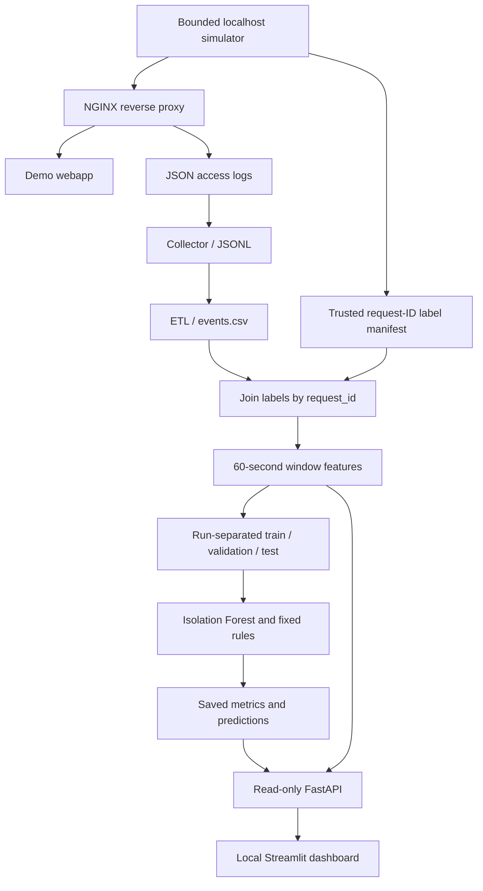

# CyberSentinel - AI-Assisted Security Telemetry Lab

**Reproducible, localhost-only security telemetry experiments with NGINX, Python, Isolation Forest, FastAPI, and Streamlit.**

> **Research/educational prototype - not a production intrusion detection system (IDS).** The dashboard explores *offline, controlled lab experiments*. The API does not perform live detection; the reported labels describe scripted simulations, not independently verified incidents.

## What works today

- **Local traffic generator:** bounded benign visits, failed logins, URL scans, and mixed scenarios against a Docker lab bound to `127.0.0.1`.
- **Telemetry pipeline:** NGINX JSON access logs → Python collector → JSONL/CSV ETL → request-ID-linked simulation labels. Unmatched events stay **unlabeled**.
- **Behavioral features:** 14 numeric aggregates in 60-second, per-source, per-simulation-run windows for offline analysis.
- **ML experiment:** Isolation Forest fitted on benign training windows, threshold calibrated on benign validation windows, compared with a fixed-rule baseline on run-separated holdout data.
- **Reproducibility and robustness:** saved split manifest and metrics, counterfactual feature-space checks, Python 3.12/3.13 tests, and a Docker end-to-end smoke test in CI.
- **Offline dashboard:** read-only FastAPI endpoints and a four-page Streamlit explorer (Overview, Traffic Explorer, Model Evaluation, Robustness).
- **Public security checker:** HTTPS configuration checks without intrusive scanning; separate static research showcase.
- **Local owner onboarding and agent ingestion:** DNS TXT domain proof, scoped/revocable agent keys, NGINX JSONL adapter, minimized request metadata and owner-only event history. All Step 11 services remain localhost-only, not hosted online.

## Example laboratory results (24 October 2026)

| Experiment property | Recorded value |
|---|---:|
| Independent simulated runs | 160 (40 per scenario) |
| Requests with simulation labels | 2,678 of 2,678 simulated requests |
| Missing manifest-to-event matches | 0 |
| Window-level records | 160 |
| Numeric ML features | 14 |
| Benign windows used to fit Isolation Forest | 24 |
| Holdout test windows | 32 (8 benign + 24 attacks) |
| Isolation Forest precision / recall / F1 (test) | 1.000 / 0.2917 / 0.4516 |
| Isolation Forest average precision (test) | 0.8839 |
| Rule-based baseline precision / recall / F1 (test) | 1.000 / 1.000 / 1.000 |
| Isolation Forest scanning recall (test) | **0 / 8** |

**Interpret carefully.** These are results supplied from one controlled local run, not metrics for real-world threats. Fixed templates, simplified benign traffic, and the attack-heavy test class balance make cross-dataset generalization unproven. In particular, the Isolation Forest missed **17 of 24** test attack windows. The stronger rule-based result is an *easy synthetic-lab baseline*, not evidence of production reliability. See [Experiment Results](docs/EXPERIMENT_RESULTS.md).

## Architecture



Details: [Architecture](docs/PROJECT_ARCHITECTURE.md) · [Security and limitations](docs/SECURITY_AND_LIMITATIONS.md).

## Requirements

- Python **3.12 or 3.13** and `venv`
- Docker + Docker Compose to generate new local telemetry (not needed to view saved results)
- Git, and access to `127.0.0.1` ports **8080** (lab), **8001** (API), **8501** (dashboard), **8002** (local owner API), **8503** (local owner portal)
- Dependencies in `requirements-ml.txt`, `requirements-dashboard.txt`, `requirements-owner.txt`, and the optional local agent `pyproject.toml`

## Quick start - inspect existing local results

Run from the repository root:

```bash
python3 -m venv .venv
source .venv/bin/activate
python -m pip install -r requirements-ml.txt -r requirements-dashboard.txt
python -m unittest discover -s tests -v
```

**Terminal A:**

```bash
source .venv/bin/activate
uvicorn dashboard_api.main:app --host 127.0.0.1 --port 8001
```

**Terminal B:**

```bash
source .venv/bin/activate
streamlit run dashboard/app.py --server.address 127.0.0.1 --server.port 8501
```

Open **http://127.0.0.1:8501**, and optionally the API documentation at **http://127.0.0.1:8001/docs**. Verify the backend via:

```bash
curl --noproxy '*' http://127.0.0.1:8001/api/health
curl --noproxy '*' http://127.0.0.1:8001/api/runs
```

A fresh checkout normally has **no experiment data**: generated files under `simulations/runtime/` are intentionally ignored by Git. The app will report that no runs exist until you generate them. Do not expect screenshots or metrics files to be downloaded by cloning this repository.

## Reproduce a new local ML experiment

**Only run this simulation against the provided localhost lab.** In the repository root, with the virtual environment active:

```bash
docker compose -f simulations/docker-compose.yml up --build -d --wait
curl --noproxy '*' http://127.0.0.1:8080/health
python -m scripts.run_lab_experiments --runs-per-class 40 --seed 42

RUN_DIR=$(find simulations/runtime/processed -maxdepth 1 -type d -name 'step5_*' | sort | tail -n 1)
cat "$RUN_DIR/data_summary.json"

python -m scripts.train_detector \
  --input "$RUN_DIR/window_features.csv" \
  --output-dir "$RUN_DIR/ml_results" \
  --seed 42 --target-fpr 0.05 --trees 200
cat "$RUN_DIR/ml_results/metrics.json"

python -m scripts.audit_detector_robustness \
  --input "$RUN_DIR/window_features.csv" \
  --ml-results "$RUN_DIR/ml_results" \
  --output "$RUN_DIR/ml_results/robustness_report.json"

docker compose -f simulations/docker-compose.yml down
```

**Check before trusting results:** `matched_labeled_events == simulation_requests`, `manifest_records_without_event == 0`, and no run ID appears in multiple train/validation/test partitions. Results may vary with timing and library versions. The split manifest and `metrics.json` capture the actual experiment details. See [Reproducibility](docs/REPRODUCIBILITY.md).

## Quality checks

```bash
python -m unittest discover -s tests -v
python -m scripts.release_audit
```

The release audit checks repository layout and looks for accidentally tracked runtime datasets, serialized models and credential-like filenames. It is a **limited packaging check**, not a malware scanner or security certification. GitHub Actions also runs Python tests and the Docker localhost pipeline for pull requests.

## Repo map

| Path | Role |
|---|---|
| `simulations/` | Local NGINX + demo webapp; generated logs excluded from Git |
| `scripts/collector.py`, `scripts/etl.py` | Ingest and normalize HTTP events |
| `scripts/attack_replay.py`, `scripts/run_lab_experiments.py` | Controlled loopback-only replay and repeated lab sessions |
| `scripts/build_labeled_dataset.py`, `scripts/build_window_features.py` | Trusted labeling and numeric aggregation |
| `scripts/train_detector.py`, `scripts/audit_detector_robustness.py` | Baseline model evaluation and frozen-model audit |
| `dashboard_api/`, `dashboard/` | Local read-only API, public checker and Streamlit applications |
| `owner_api/`, `owner_portal/` | Local-only domain verification, key management, owner telemetry view |
| `cybersentinel_agent/`, `pyproject.toml` | Local-only NGINX JSONL adapter, installable CLI package |
| `scripts/normalize_dashes.py` | Convert em/en dashes to ASCII hyphens in Git-tracked text |
| `.github/workflows/ci.yml`, `tests/` | Continuous integration and regression tests |
| `docs/` | Architecture, reproducibility, methodology and limitations |

## Limitations and next research steps

1. Source-IP attribution is not trustworthy: `X-Forwarded-For` can be supplied by the client in this lab.
2. Per-run aggregation is valid for experiment bookkeeping, **not** for a deployed live detector, which cannot know simulation run IDs.
3. The fixed scan paths and simple benign request patterns may overstate generalization. A stronger future study needs authentic benign errors, more varied attack behavior and an independent dataset.
4. Validation includes only eight benign windows in the recorded study; a target 5% false-positive rate is therefore coarsely estimated.
5. A local-only owner account prototype and scoped telemetry ingestion exist, but there is no managed hosted authentication, production RBAC, public ingress, continuous agent daemon or real-time alerting. Keep owner services bound to loopback.

**This project demonstrates a reproducible experimental workflow, not a security product.**

## Local owner agent (Step 11)

The optional owner service is **not hosted online**. With a DNS-verified domain in the local owner portal, create a one-time agent key, then use the installable CLI to deliver up to 25 fresh sanitized NGINX events per request:

```bash
python -m pip install -r requirements-owner.txt -r requirements-dashboard.txt
python -m pip install -e .
uvicorn owner_api.main:app --host 127.0.0.1 --port 8002
# In another terminal, with CYBERSENTINEL_AGENT_KEY set:
cybersentinel-agent --input simulations/runtime/owner/step11_demo_nginx.jsonl \
  --domain-id YOUR_VERIFIED_DOMAIN_ID
```

See [Step 11 setup](docs/HUONG_DAN_BUOC_11.md) and [Owner agent security](docs/OWNER_AGENT_SECURITY.md) before using any logs. No raw IP, full URL, query, cookie, user-agent or request body is uploaded; the source reference is a daily HMAC pseudonym.

## Documentation

[Experiment results](docs/EXPERIMENT_RESULTS.md) · [Architecture](docs/PROJECT_ARCHITECTURE.md) · [Reproducibility](docs/REPRODUCIBILITY.md) · [Security & limitations](docs/SECURITY_AND_LIMITATIONS.md) · [Demo checklist](docs/PORTFOLIO_DEMO.md)

## Contributors

- [idozii](https://github.com/idozii) - Data Science
- [Vincent](https://github.com/nguyentr4n14) - Software Development
- [Dcornel](https://github.com/cornel05) - ML Engineering
- [DarealDanh](https://github.com/darealDanh) - Lab Attack Simulation

_Contributions above reflect the project's stated team roles; consult Git history for specific authorship._
