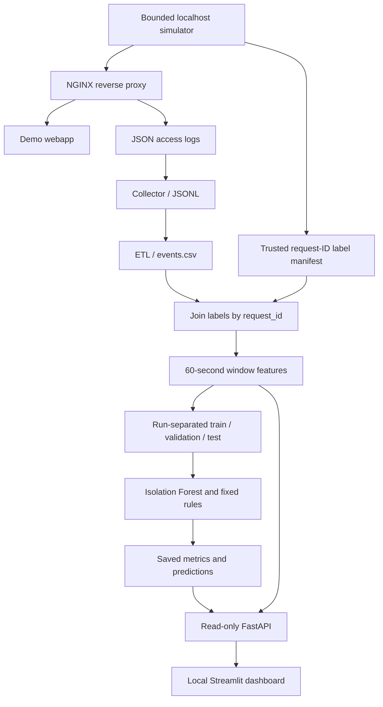

# CyberSentinel - AI-Assisted Security Telemetry Lab

**Reproducible, localhost-only security telemetry experiments with NGINX, Python, Isolation Forest, FastAPI, and Streamlit.**

> **Research/educational prototype - not a production intrusion detection system (IDS).** The dashboard explores *offline, controlled lab experiments*. The API does not perform live detection; the reported labels describe scripted simulations, not independently verified incidents.

## What works today

- **Local traffic generator:** bounded benign visits, failed logins, URL scans, and mixed scenarios against a Docker lab bound to `127.0.0.1`.
- **Telemetry pipeline:** NGINX JSON access logs → Python collector → JSONL/CSV ETL → request-ID-linked simulation labels. Unmatched events stay **unlabeled**.
- **Behavioral features:** 14 numeric aggregates in 60-second, per-source, per-simulation-run windows for offline analysis.
- **ML experiment:** Isolation Forest fitted on benign training windows, threshold calibrated on benign validation windows, compared with a fixed-rule baseline on run-separated holdout data.
- **Reproducibility and robustness:** saved split manifest and metrics, counterfactual feature-space checks, Python 3.12/3.13 tests, and a Docker end-to-end smoke test in CI.
- **Offline dashboard:** read-only FastAPI endpoints and a four-page Streamlit explorer (Overview, Traffic Explorer, Model Evaluation, Robustness).
- **Public security checker:** HTTPS configuration checks without intrusive scanning; separate static research showcase.
- **Local owner onboarding and agent ingestion:** DNS TXT domain proof, scoped/revocable agent keys, NGINX JSONL adapter, minimized request metadata and owner-only event history. All Step 11 services remain localhost-only, not hosted online.

## Example laboratory results (24 October 2026)

| Experiment property | Recorded value |
|---|---:|
| Independent simulated runs | 160 (40 per scenario) |
| Requests with simulation labels | 2,678 of 2,678 simulated requests |
| Missing manifest-to-event matches | 0 |
| Window-level records | 160 |
| Numeric ML features | 14 |
| Benign windows used to fit Isolation Forest | 24 |
| Holdout test windows | 32 (8 benign + 24 attacks) |
| Isolation Forest precision / recall / F1 (test) | 1.000 / 0.2917 / 0.4516 |
| Isolation Forest average precision (test) | 0.8839 |
| Rule-based baseline precision / recall / F1 (test) | 1.000 / 1.000 / 1.000 |
| Isolation Forest scanning recall (test) | **0 / 8** |

**Interpret carefully.** These are results supplied from one controlled local run, not metrics for real-world threats. Fixed templates, simplified benign traffic, and the attack-heavy test class balance make cross-dataset generalization unproven. In particular, the Isolation Forest missed **17 of 24** test attack windows. The stronger rule-based result is an *easy synthetic-lab baseline*, not evidence of production reliability. See [Experiment Results](docs/EXPERIMENT_RESULTS.md).

## Architecture



Details: [Architecture](docs/PROJECT_ARCHITECTURE.md) · [Security and limitations](docs/SECURITY_AND_LIMITATIONS.md).

## Requirements

- Python **3.12 or 3.13** and `venv`
- Docker + Docker Compose to generate new local telemetry (not needed to view saved results)
- Git, and access to `127.0.0.1` ports **8080** (lab), **8001** (API), **8501** (dashboard), **8002** (local owner API), **8503** (local owner portal)
- Dependencies in `requirements-ml.txt`, `requirements-dashboard.txt`, `requirements-owner.txt`, and the optional local agent `pyproject.toml`

## Quick start - inspect existing local results

Run from the repository root:

```bash
python3 -m venv .venv
source .venv/bin/activate
python -m pip install -r requirements-ml.txt -r requirements-dashboard.txt
python -m unittest discover -s tests -v
```

**Terminal A:**

```bash
source .venv/bin/activate
uvicorn dashboard_api.main:app --host 127.0.0.1 --port 8001
```

**Terminal B:**

```bash
source .venv/bin/activate
streamlit run dashboard/app.py --server.address 127.0.0.1 --server.port 8501
```

Open **http://127.0.0.1:8501**, and optionally the API documentation at **http://127.0.0.1:8001/docs**. Verify the backend via:

```bash
curl --noproxy '*' http://127.0.0.1:8001/api/health
curl --noproxy '*' http://127.0.0.1:8001/api/runs
```

A fresh checkout normally has **no experiment data**: generated files under `simulations/runtime/` are intentionally ignored by Git. The app will report that no runs exist until you generate them. Do not expect screenshots or metrics files to be downloaded by cloning this repository.

## Reproduce a new local ML experiment

**Only run this simulation against the provided localhost lab.** In the repository root, with the virtual environment active:

```bash
docker compose -f simulations/docker-compose.yml up --build -d --wait
curl --noproxy '*' http://127.0.0.1:8080/health
python -m scripts.run_lab_experiments --runs-per-class 40 --seed 42

RUN_DIR=$(find simulations/runtime/processed -maxdepth 1 -type d -name 'step5_*' | sort | tail -n 1)
cat "$RUN_DIR/data_summary.json"

python -m scripts.train_detector \
  --input "$RUN_DIR/window_features.csv" \
  --output-dir "$RUN_DIR/ml_results" \
  --seed 42 --target-fpr 0.05 --trees 200
cat "$RUN_DIR/ml_results/metrics.json"

python -m scripts.audit_detector_robustness \
  --input "$RUN_DIR/window_features.csv" \
  --ml-results "$RUN_DIR/ml_results" \
  --output "$RUN_DIR/ml_results/robustness_report.json"

docker compose -f simulations/docker-compose.yml down
```

**Check before trusting results:** `matched_labeled_events == simulation_requests`, `manifest_records_without_event == 0`, and no run ID appears in multiple train/validation/test partitions. Results may vary with timing and library versions. The split manifest and `metrics.json` capture the actual experiment details. See [Reproducibility](docs/REPRODUCIBILITY.md).


## Step 14 - Optional HTTPS staging ingest bridge

Step 14 adds a separate **ingest-only** FastAPI app (`owner_api/ingest_only.py`) and
an opt-in HTTPS agent mode to send minimized telemetry to a VPS staging endpoint.
The public surface is limited to authenticated `POST /agent/v1/ingest` behind a
Caddy exact-path rule. The private Owner API and Owner Portal stay on localhost or
behind an administrator-operated SSH tunnel. This is **not** an openly hosted
multi-user Owner Portal, a public SaaS launch, or a production security service.

See [Step 14 guide](docs/HUONG_DAN_BUOC_14.md) and
[Hosted staging security](docs/HOSTED_STAGING_SECURITY.md). Run
`python -m scripts.step14_preflight` as an additional source-level check.

## Quality checks

```bash
python -m unittest discover -s tests -v
python -m scripts.release_audit
```

The release audit checks repository layout and looks for accidentally tracked runtime datasets, serialized models and credential-like filenames. It is a **limited packaging check**, not a malware scanner or security certification. GitHub Actions also runs Python tests and the Docker localhost pipeline for pull requests.

## Repo map

| Path | Role |
|---|---|
| `simulations/` | Local NGINX + demo webapp; generated logs excluded from Git |
| `scripts/collector.py`, `scripts/etl.py` | Ingest and normalize HTTP events |
| `scripts/attack_replay.py`, `scripts/run_lab_experiments.py` | Controlled loopback-only replay and repeated lab sessions |
| `scripts/build_labeled_dataset.py`, `scripts/build_window_features.py` | Trusted labeling and numeric aggregation |
| `scripts/train_detector.py`, `scripts/audit_detector_robustness.py` | Baseline model evaluation and frozen-model audit |
| `dashboard_api/`, `dashboard/` | Local read-only API, public checker and Streamlit applications |
| `owner_api/`, `owner_portal/` | Local-only domain verification, key management, owner telemetry view |
| `cybersentinel_agent/`, `pyproject.toml` | Local-only NGINX JSONL adapter, installable CLI package |
| `owner_api/detection.py` | Explainable owner-scoped 60-second rule alerts (Step 12) |
| `scripts/normalize_dashes.py` | Convert em/en dashes to ASCII hyphens in Git-tracked text |
| `.github/workflows/ci.yml`, `tests/` | Continuous integration and regression tests |
| `docs/` | Architecture, reproducibility, methodology and limitations |

## Limitations and next research steps

1. Source-IP attribution is not trustworthy: `X-Forwarded-For` can be supplied by the client in this lab.
2. Per-run aggregation is valid for experiment bookkeeping, **not** for a deployed live detector, which cannot know simulation run IDs.
3. The fixed scan paths and simple benign request patterns may overstate generalization. A stronger future study needs authentic benign errors, more varied attack behavior and an independent dataset.
4. Validation includes only eight benign windows in the recorded study; a target 5% false-positive rate is therefore coarsely estimated.
5. A local-only owner account prototype and scoped telemetry ingestion exist, but there is no managed hosted authentication, production RBAC, public ingress, continuous agent daemon, production alert delivery or autonomous mitigation. The Step 12 local rule alerts update on ingest and refresh in an open portal. Keep owner services bound to loopback.

**This project demonstrates a reproducible experimental workflow, not a security product.**

## Local owner agent (Step 11)

The optional owner service is **not hosted online**. With a DNS-verified domain in the local owner portal, create a one-time agent key, then use the installable CLI to deliver up to 25 fresh sanitized NGINX events per request:

```bash
python -m pip install -r requirements-owner.txt -r requirements-dashboard.txt
python -m pip install -e .
uvicorn owner_api.main:app --host 127.0.0.1 --port 8002
# In another terminal, with CYBERSENTINEL_AGENT_KEY set:
cybersentinel-agent --input simulations/runtime/owner/step11_demo_nginx.jsonl \
  --domain-id YOUR_VERIFIED_DOMAIN_ID
```

See [Step 11 setup](docs/HUONG_DAN_BUOC_11.md) and [Owner agent security](docs/OWNER_AGENT_SECURITY.md) before using any logs. No raw IP, full URL, query, cookie, user-agent or request body is uploaded; the source reference is a daily HMAC pseudonym.

## Documentation

[Experiment results](docs/EXPERIMENT_RESULTS.md) · [Architecture](docs/PROJECT_ARCHITECTURE.md) · [Reproducibility](docs/REPRODUCIBILITY.md) · [Security & limitations](docs/SECURITY_AND_LIMITATIONS.md) · [Demo checklist](docs/PORTFOLIO_DEMO.md)

## Contributors

- [idozii](https://github.com/idozii) - Data Science
- [Vincent](https://github.com/nguyentr4n14) - Software Development
- [Dcornel](https://github.com/cornel05) - ML Engineering
- [DarealDanh](https://github.com/darealDanh) - Lab Attack Simulation

_Contributions above reflect the project's stated team roles; consult Git history for specific authorship._

## Local security alerts (Step 12)

Once a DNS-verified domain has an agent key, submitting sanitized HTTP telemetry to the local API computes per-source 60-second windows and produces advisory alerts for repeated login failures, HTTP 404 bursts, HTTP 5xx bursts and high request volume. Alerts are stored in SQLite under the owner's domain, can be acknowledged, and are refreshed in the local portal every 10 seconds while the browser page remains open. No Isolation Forest weights are loaded for operational decisions.

See [Step 12 guide](docs/HUONG_DAN_BUOC_12.md) and [Detection design](docs/OWNER_DETECTION_DESIGN.md). This is an opt-in localhost demonstration, not hosted threat monitoring or a production intrusion detection service.

## Continuous local log follower (Step 13)

The optional `cybersentinel-agent-watch` command tails a local NGINX JSONL file, persists sanitized events and a file cursor in an owner-only SQLite outbox, and retries HTTP delivery to the localhost Owner API. It handles common rename-based log rotation and basic copytruncate detection.

```bash
python -m pip install -e .
cybersentinel-agent-watch --input simulations/runtime/logs/access.log \
  --state simulations/runtime/owner/nginx_watcher.sqlite3 \
  --domain-id YOUR_VERIFIED_DOMAIN_ID --poll-seconds 1
```

Set `CYBERSENTINEL_AGENT_KEY` locally first. The default on a new state file is to start at the end of the existing log. Use `--from-start` only for a new, fresh demonstration log. The backend still accepts only events within five minutes, so old queue items require operator attention. This is not hosted 24/7 monitoring. See [Step 13 instructions](docs/HUONG_DAN_BUOC_13.md) and [Reliability design](docs/AGENT_RELIABILITY.md).

## Private owner staging operations (Step 15)

Step 15 adds private SSH-tunnel access to the staging Owner Portal and safe, operator-run
SQLite backup, restore verification and retention commands. The portal stays bound
to 127.0.0.1, and the public Caddy proxy still serves only agent ingestion.
This is not public signup or hosted multi-tenant SaaS.

```bash
python -m scripts.step15_ops inspect
python -m scripts.step15_ops retention
python -m scripts.step15_ops backup
python -m scripts.step15_preflight
```

Backups contain sensitive owner information and must remain private and encrypted
before off-host transport. See [Step 15 guide](docs/HUONG_DAN_BUOC_15.md) and
[Operations security](docs/STEP15_OPERATIONS_SECURITY.md).

## Private PostgreSQL and OIDC pilot (Step 16)

Step 16 adds a **separate localhost-only** API under `hosted_api/` to validate
OIDC RS256 access tokens and store identity-scoped domain claims in PostgreSQL.
The migration enforces FORCE ROW LEVEL SECURITY with a dedicated unprivileged
application role, and CI runs an actual PostgreSQL 17 isolation test.

**Not migrated:** prior SQLite accounts, telemetry, agent keys, and alerts.
No browser OAuth login, public signup, or internet-facing owner portal is
delivered in Step 16. Existing APIs and dashboards remain unchanged.

See [Step 16 guide](docs/HUONG_DAN_BUOC_16.md) and [identity/database security](docs/STEP16_DATABASE_IDENTITY_SECURITY.md).

## Step 16-17 - Neon/PostgreSQL and private Auth0 browser login

The new `hosted_api/` stack is a separate local-only staging pilot. It does not
replace the SQLite Owner API or the remote HTTPS ingest bridge from Steps 10-15.
Neon schema `cs` uses a restricted Postgres runtime role and actor-scoped RLS.
Step 17 adds a server-side Authorization Code + PKCE login for a private owner
web portal on `http://127.0.0.1:8007`. Browser sessions stay in process memory,
are short-lived and never contain bearer tokens in browser-accessible storage.
Owner domain claims and DNS TXT verification use the PostgreSQL schema.

See `docs/HUONG_DAN_BUOC_16.md` and `docs/HUONG_DAN_BUOC_17.md`.
This is **not public SaaS**: PostgreSQL telemetry and alerts are not migrated,
there is no distributed session store, HTTPS web-cookie configuration or audited
production login deployment. Never bind the private portal to `0.0.0.0`.

## Step 18 - Private PostgreSQL monitoring pilot

A separately gated PostgreSQL telemetry/alerts stack is available for localhost
staging. It includes checksum migration 002, three FORCE RLS tables, per-domain
hashed agent keys, idempotent event ingestion, rule-based alerts and Auth0
owner portal controls. Existing SQLite agent and public showcase are unchanged.
Follow [Step 18 instructions](docs/HUONG_DAN_BUOC_18.md) and
[security limitations](docs/STEP18_MONITORING_SECURITY.md). Do not expose the
new port 8008 publicly or deploy without the PostgreSQL CI integration tests.


## Step 19 - Isolated localhost demo (no domain / Auth0 / Neon)

Step 19 provides a completely separate, **opt-in, in-memory-only** simulation on
`http://127.0.0.1:8019`. It generates a fake demo domain and local-only `csd_`
agent keys, accepts synthetic NGINX telemetry using the existing CLI adapter,
and displays explainable alert rules. It does **not** bypass DNS verification
on the real owner portal (8007) or modify PostgreSQL (8008).

```bash
export CYBERSENTINEL_LOCAL_DEMO=1
uvicorn hosted_api.local_demo:factory --factory --host 127.0.0.1 --port 8019 --workers 1
```

Open `http://127.0.0.1:8019/`, click "Generate new local demo key", copy the
one-time key and the displayed demo domain ID. Then follow
[Step 19 instructions](docs/HUONG_DAN_BUOC_19.md) and
[isolation and limitations](docs/STEP19_DEMO_SECURITY.md).
All demo data and keys disappear on restart. Never run this service publicly.


## Step 20 - Synthetic detection quality evaluation (offline)

Step 20 benchmarks the Step 19 rule engine on **14 deliberately labeled synthetic
scenarios**: normal below-threshold requests, alert-triggering patterns, two
plausible benign false alarms and two low-rate missed patterns. The unit of
measurement is a **scenario-rule pair**, not a real attack or HTTP request.
The benchmark does not test Isolation Forest ML or production detection.

```bash
python -m scripts.step20_evaluate
python -m scripts.step20_evaluate --output-dir /tmp/cybersentinel-step20-report
python -m unittest discover -s tests -p test_step20_evaluation.py -v
python -m scripts.step20_preflight
```

Reports are JSON and Markdown, written with owner-only permissions into a
brand-new directory **outside the Git repository**. The default sample fixture
produces TP=4, FP=2, FN=2 and TN=48 (micro precision, recall and F1 = 0.6667);
these values are illustrative and must never be presented as real-world
cyberattack accuracy. No demo keys, user traffic, Auth0 tokens or Neon data are
included. On the opt-in localhost demo `http://127.0.0.1:8019/`, visit
`/demo/evaluation` for a read-only overview; it does not reset existing demo
events or keys.

See [Step 20 instructions](docs/HUONG_DAN_BUOC_20.md) and
[benchmark limitations](docs/STEP20_EVALUATION_LIMITATIONS.md).

### Step 21 - Offline synthetic quality gate and threshold sensitivity

Step 21 compares a bounded 81-candidate threshold grid against the frozen Step 20
hand-labeled scenarios using an explicit 8-scenario development and 6-scenario
synthetic validation split. The split illustrates overfitting: a development
improvement does not establish generalization. The candidate is **never**
automatically applied to local demo, PostgreSQL staging, or production rules.

```bash
python -m scripts.step21_preflight
python -m unittest discover -s tests -p test_step21_tuning.py -v
python -m scripts.step21_quality_gate
python -m scripts.step21_quality_gate --output-dir /tmp/cyber-step21-report
```

In the isolated localhost Demo (`CYBERSENTINEL_LOCAL_DEMO=1`, port `8019`),
open `/demo/tuning`. No Auth0, domain, Neon access, or migration is needed.
See `docs/HUONG_DAN_BUOC_21.md` and `docs/STEP21_QUALITY_LIMITATIONS.md`.


## Fast-track Steps 22-25 - Local Portfolio MVP

The localhost-only demo now includes alert triage, aggregate evidence drilldown,
a `cybersentinel-demo-agent` one-shot client, supplemental synthetic robustness
checks and a reproducible release smoke test. No DNS, Auth0 or Neon required.
See `docs/HUONG_DAN_BUOC_22_25.md` and `docs/LOCAL_MVP_RELEASE.md`.

```bash
python -m pip install -e .
python -m scripts.step25_preflight
python -m scripts.step25_release
python -m scripts.step25_demo
```

Open `http://127.0.0.1:8019/`. No production security claims: the local
single-tenant dataset disappears on restart; agent buffering, hosted deployment,
real-world validation and independent review remain future work.

## Fast-track Steps 26-30 - Private deployment/beta-readiness rehearsal

The [Steps 26-30 runbook](docs/HUONG_DAN_BUOC_26_30.md) adds an offline
non-networked Docker smoke, runtime RLS audit, in-memory local operations
counters, synthetic reliability drills, and an explicit limited-beta
Go/No-Go gate. **It does not make the system public or production-ready.**

Run `python -m scripts.step26_30_release` from a clean local environment.
The private demo operations view is at `http://127.0.0.1:8019/demo/operations`
when the local Step 25 demo is running. The beta gate must remain BLOCKED
until independent review and actual deployment/consent/operational evidence.
See [beta limitations](docs/BETA_GO_NO_GO.md).

## SOC UI v2 and beta preparation (Steps 31-32)

The isolated `http://127.0.0.1:8019/` demo now includes a responsive SOC-style dashboard with live-in-memory synthetic KPIs, event activity, HTTP response breakdown, alerts and an agent setup panel. Navigation links connect to existing triage, evaluation, tuning and operations pages. The new `/demo/readiness` page reports the unchanged NO-GO beta gate. No external UI assets, cloud hosting or production data are introduced.

Start with `python -m scripts.step25_demo` and read `docs/HUONG_DAN_BUOC_31_32.md`. This is still a private localhost portfolio MVP, not a public beta or production SaaS.


### Steps 33-35 - Durable watcher bridge (development-only)

Existing Step 13 SQLite outbox now supports `csd_` localhost demo keys on
`127.0.0.1:8019` and `csp_` PostgreSQL staging keys on `127.0.0.1:8008`
or a strictly approved HTTPS origin, without changing the authenticated
server behavior. Inspect queue health using:

```bash
python -m cybersentinel_agent.state_cli --state simulations/runtime/owner/demo-step33.sqlite3
```

See `docs/HUONG_DAN_BUOC_33_35.md` for the end-to-end localhost run and
`docs/STEP33_35_DELIVERY_LIMITATIONS.md` for TTL, loss, capacity, and
identity-rotation caveats. Local MVP and public beta remain distinct.
