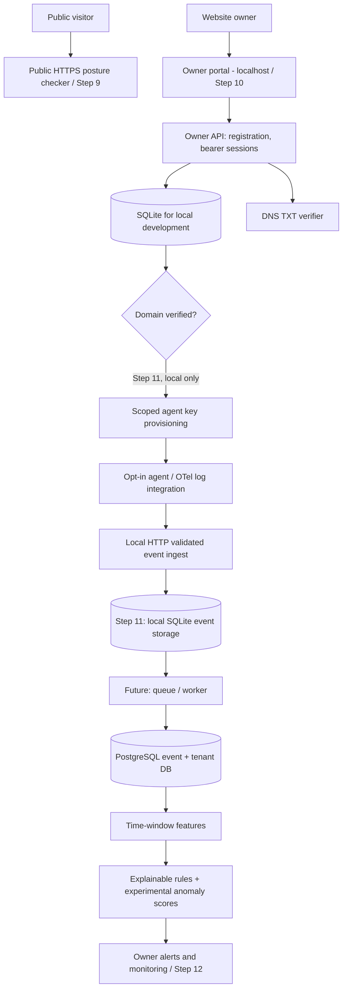

# CyberSentinel - Product Architecture and Owner Roadmap

## Two user journeys, one brand

1. **General visitors**: Public Streamlit website checks observable HTTPS configuration without credentials. Static research-showcase metrics are separate from live header checks.
2. **Website owners**: After account creation and DNS TXT verification, users can connect a local, one-shot NGINX agent in Step 11; this should eventually become a dedicated HTTPS web application and auth service rather than sharing the public Streamlit runtime.

## Product components and boundaries

**Implemented Steps 10-11**: local account, login, session, domain claim, DNS TXT lookup, verification, user isolation, revocable scoped agent keys and local-only bounded ingestion of sanitized NGINX JSONL metadata. Continuous remote collection, HTTPS edge, worker, PostgreSQL and live alerts remain **planned**.

## Step 11 local event schema and future live-window work

The Step 11 event includes an HMAC event ID, timestamp, HMAC daily source alias, categorical path group, validated HTTP method/status, duration and byte counts. Server-side domain identity is resolved from a hashed, verified-domain-scoped agent key; it is not trusted from a caller-supplied owner ID. Do not collect cookies, authorization headers, passwords, raw query strings, request bodies, or unrestricted User-Agent values by default.

The real-time window grouping must derive from `service_id` and wall-clock time and optional pseudonymous source; lab `simulation_run_id` must remain strictly experimental metadata. Processing should deduplicate events and handle clock skew, rate limits and backpressure. Initial detection should use bounded transparent rule checks; anomaly scores remain supplemental until validated on independent owner-consented data.

## Production-readiness gates

| Gate | Required before real users | Step |
|---|---|---|
| Identity | OIDC / managed auth, verified accounts, MFA, reset, secure web sessions | 11 preflight |
| Persistence | PostgreSQL + migrations + backups + tenant enforcement | 11 preflight |
| DNS proof | Secure DNS TXT verification plus expiry/reverify/transfer lifecycle | 10 prototype / 11 production |
| Ingestion | Scoped rotating/revocable keys, TLS, client quotas, event schema, minimal PII | 11 local prototype; TLS edge future |
| Live analytics | Worker, time-window features, repeatable policy and evaluation | 12 |
| Security operations | Abuse monitoring, rate limits, observability, alert delivery, retention | 12 |
| Model governance | Independent benign/attack datasets, false-positive confidence and no hidden test tuning | Research track |

## Reference material

- OWASP: https://cheatsheetseries.owasp.org/cheatsheets/Password_Storage_Cheat_Sheet.html
- OWASP: https://cheatsheetseries.owasp.org/cheatsheets/Authentication_Cheat_Sheet.html
- OWASP: https://cheatsheetseries.owasp.org/cheatsheets/Session_Management_Cheat_Sheet.html
- ACME DNS control concept (distinct from CyberSentinel-specific proof): https://letsencrypt.org/docs/challenge-types/

**Note:** DNS TXT verification demonstrates that the applicant can influence DNS records for the nominated hostname at verification time. It does not by itself prove lawful ownership, continued control or authorization to access historical telemetry.
