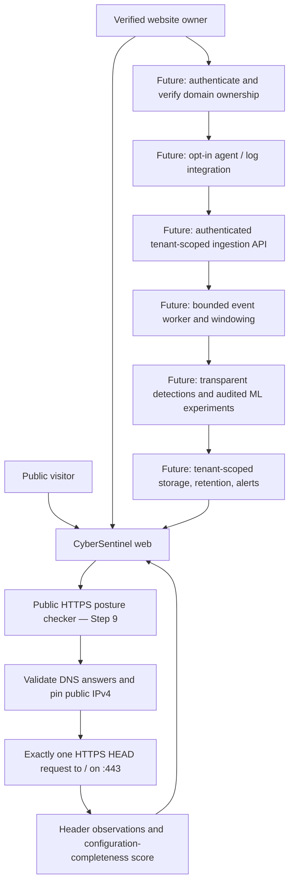

# CyberSentinel Product Architecture — Two Audience Modes

**Status (Step 9):** Public passive HTTPS posture checker is implemented. Research showcase is retained. Owner live monitoring is a **planned product**, not an implemented feature.

## Two distinct trust and data paths

### Boundary A — public checker (implemented now)

A public website checker provides strictly **limited observations**, not security assurance:

- Public DNS hostname required; no localhost, private IPs, IP literals, ports, credentials, paths, redirects or custom request methods.
- Resolve A/AAAA; reject any non-public resolved destination; pin approved **IPv4** address for TLS connection, avoiding second hostname DNS resolution.
- `HEAD / HTTP/1.1` over verified TLS, HTTPS port 443 only; a single connection with timeout.
- Do not follow redirects; do not probe login paths, vulnerability endpoints, subdomains, scripts or credentials.
- Evaluate HSTS, CSP presence, nosniff, Referrer-Policy, Permissions-Policy presence and framing protection.
- 0–100 points mean **configuration completeness of six observations**, *not* safety, compliance or likelihood of compromise.
- Some HEAD-rejecting/redirecting or IPv6-only sites cannot be scored in this MVP.
- Checks are transient: no server-side storage is added by Step 9; target hosts and DNS resolvers can still observe network activity.
- A browser-session demo quota (3 checks/10 minutes) does **not** stop global abuse. Before serious public exposure, add deployment-level request quotas, bot protection, monitored egress filtering, resource/cost budgets, and security review.

### Boundary B — owner monitoring (planned, NOT implemented)

Owner control and tenant boundaries must be prerequisites for sending security telemetry:

1. **Account & domain proof:** authenticated session; verify with rotating DNS TXT challenge (`_cybersentinel-verify.<domain>`) or HTTPS challenge; domain is tied to account/tenant. Define challenge expiry, ownership revalidation, safe DNS resolution and tenant transfer rules.
2. **Agent onboarding:** owner chooses an NGINX access-log adapter or OpenTelemetry/FastAPI instrumentation. Document exactly what is collected and support revoke/remove.
3. **Authenticated ingestion:** mutually authenticated TLS or short-lived scoped tokens; per-agent identity, timestamps, nonce/replay defense, payload size bounds, idempotent event IDs, per-tenant quotas. Do not ingest request bodies, passwords, cookies, session tokens, authorization headers or query values by default.
4. **Ingestion queue + pipeline:** derive event time, verify timestamps, deduplicate request IDs, aggregate by **(tenant, service, trusted client IP, time bucket)**. The laboratory's `simulation_run_id` must never be required by real monitoring. Handle late events, skew, missing headers and backpressure.
5. **Detection:** start with explainable rules. Run anomaly scores only as an experimental supplement until independent benign/attack evaluations demonstrate acceptable recall and alert burden. Never equate a low configuration score with an active attack.
6. **Owner dashboard:** overview, live traffic, evidence-backed alerts, acknowledge/silence, retention/delete/export and audit trail. Push via WebSocket/SSE later; polling is sufficient for a first owner MVP.

## Logical data model — future owner service

| Table / collection | Important fields | Key rule |
|---|---|---|
| `tenants` | id, owner_id, created_at | Every resource scoped to tenant |
| `domains` | id, tenant_id, fqdn, verification_status, verified_at | Verify before enabling agent or active checks |
| `agents` | id, tenant_id, service_id, token_hash, revoked_at | Store token hashes, not plaintext secrets |
| `events` | id, tenant_id, service_id, timestamp, method, path_category, status, duration | Minimal/redacted data, TTL and quotas |
| `windows` | tenant_id, service_id, source_key, window_start, feature_vector | No simulation run ID in live inference |
| `alerts` | id, tenant_id, detector, severity, evidence, created_at, status | Explainable and auditable, avoid silent blocking |

**Technology choices:** FastAPI API/worker; managed PostgreSQL for owners/configuration; partitioned event storage with retention for telemetry; a queue for asynchronous processing; React/Next.js when multiple tenants and complex session authentication justify it. Keep Streamlit as public demo, not the 24/7 ingestion backbone.

## Suggested build order

- **Step 9 (now):** passive HTTPS posture checker on existing public Streamlit app, with SSRF tests and research showcase preserved.
- **Step 10:** owner auth, domain ownership verification and tenant-scoped dashboard skeleton; no agent data before verification.
- **Step 11:** installable Python/NGINX telemetry agent with opt-in ingestion to authenticated FastAPI backend, validation and event storage.
- **Step 12:** bounded live window processing, first explainable alerts and near-real-time dashboard updates.
- **Step 13:** independent detection evaluation, operational privacy/security audit, load tests, rate limits and deployment review.

## Threat model and limitations

- Untrusted URL input is a potential SSRF primitive. Prevent redirect following, pin and validate destination IP, add network egress policy and multi-user quotas in hosting environment.
- Untrusted user-agent, forwarded headers and IP fields must not establish identity; only a configured trusted reverse-proxy chain can provide a verified client IP. For NAT/proxy traffic, counting by client IP has limitations.
- Multi-tenancy risks include IDOR, leaked API keys, tenant-crossing queries and accidental public log disclosure. Prefer default-deny authorization and per-tenant tests at every layer.
- Browser extensions only see activity in their permission scope, not global server traffic. Defer extension until a stable owner API exists.
- No security score produced here proves an origin is free of vulnerabilities, threats or malware.
