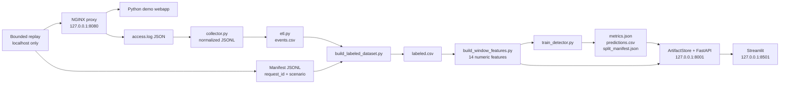

# CyberSentinel - System Architecture

## Scope

CyberSentinel is a local, educational telemetry pipeline and offline experiment explorer. It is **not a production IDS, SOC, SIEM, or online prediction service**. All simulation traffic generated by project scripts is restricted to the loopback address. The API and dashboard are intended to be bound to `127.0.0.1`.

## System data flow

The simulator labels are placed in a separate trusted manifest and joined **only by NGINX-issued `request_id`**. Logs that lack a manifest match remain `unlabeled` and are excluded from supervised windows. The replay labels should not be confused with independently validated malicious behavior.

## Component responsibilities

| Component | Inputs | Outputs | Trust/safety boundary |
|---|---|---|---|
| Docker demo webapp | Local HTTP | HTTP 200/401/404 | Demo credentials only, not production authentication |
| NGINX | Proxy requests | JSON access logs, request ID | `X-Forwarded-For` is untrusted, not identity proof |
| Collector/ETL | Structured logs | JSONL, CSV events | Schema normalization; validate telemetry |
| Manifest join | Events, script manifest | Labeled rows | Join by `request_id`; reject duplicates and missing manifest under strict mode |
| Feature aggregation | Labeled events | Per-run/per-IP/per-minute numeric windows | Exclude identifier/label columns from model inputs |
| Training/evaluation | Window rows | Frozen model, evaluation artifacts | Train only on benign training windows; threshold from benign validation |
| Robustness audit | Saved test split, own trusted model | Offline what-if report | Never refit model from holdout data |
| ArtifactStore/FastAPI | Local JSON/CSV | Read-only HTTP API | Run ID validated; bounded files; no model deserialization |
| Streamlit | Local API | Visual analytics | Not a real-time warning system; loopback only |

## Model inputs and metadata

The model uses these **14 numeric** inputs: `request_count`, `request_rate_per_second`, `get_ratio`, `post_ratio`, `login_attempt_count`, `failed_login_count`, `unique_path_count`, `http_401_ratio`, `http_404_ratio`, `http_4xx_ratio`, `query_ratio`, `mean_duration_ms`, `mean_request_bytes`, `mean_response_bytes`.

Labels, `simulation_run_id`, `request_id`, source IP, raw paths and User-Agent values are not passed as direct numeric model inputs. Counts and rates derived from HTTP status and request path remain behavior-dependent; they can still overfit the *simulated scenario design*.

## Evaluation boundary versus deployment boundary

Offline windows are grouped by simulation run to avoid mixing those groups between train/validation/test. **A deployment cannot know `simulation_run_id`**; it would need an event-time window keyed by verified source/network identity, streaming ingestion, backpressure handling, authentication and incident-management processes. None of these production controls are currently implemented.

## Generated artifacts and storage

Local results are written under `simulations/runtime/processed/step5_*/` and intentionally ignored by `.gitignore`. Files include `data_summary.json`, `events.csv`, `labeled.csv`, `window_features.csv`, and under `ml_results/`: `metrics.json`, `predictions.csv`, `split_manifest.json`, `isolation_forest.joblib`, `robustness_report.json`. The dashboard **never loads `.joblib`** and does not expose raw access-log payloads. Only load your own trusted `.joblib` in offline audit scripts; `joblib` uses pickle-like deserialization.
